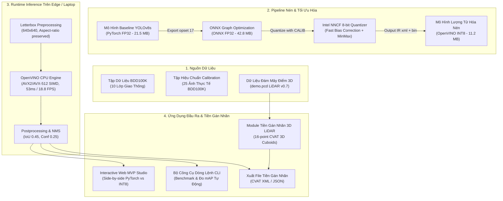

# M38: Model Compression for Edge Pre-Labeling (BDD100K)

[](https://www.python.org/)
[](https://pytorch.org/)
[](https://docs.openvino.ai/)
[](https://onnxruntime.ai/)
[](docs/TESTING_REPORT.md)
[](LICENSE)
[](docs/SUBMISSION_CHECKLIST.md)

> **Hệ thống nén mô hình thị giác máy tính phục vụ tiền gán nhãn dữ liệu xe tự hành (BDD100K) trực tiếp trên CPU laptop/edge. Đạt tốc độ xấp xỉ 19 FPS (tăng tốc 2.94x), nén dung lượng 3.8x với độ sụt giảm mAP@50 chỉ 2.64%. Tích hợp giao diện Web Edge Pre-Labeling Studio tương tác và module mở rộng đám mây điểm 3D LiDAR chuẩn CVAT 3D.**

---

## 1. Điểm Nổi Bật (Executive Summary & Key Results)

| Tiêu Chí Đánh Giá (Metric) | Baseline PyTorch FP32 | ONNX Runtime FP32 | OpenVINO FP16 | **OpenVINO INT8 (Ours)** | Cải Thiện (Improvement) |
|---|---|---|---|---|---|
| **Độ trễ P50 (Latency)** | 156.31 ms | 123.66 ms | 157.01 ms | **53.17 ms** | **Nhanh gấp 2.94x** (giảm 66% thời gian) |
| **Độ trễ P95 (Latency)** | 172.48 ms | 134.19 ms | 175.82 ms | **62.45 ms** | Giảm từ 172.48ms xuống 62.45ms |
| **Tốc độ xử lý (Throughput)** | 6.4 FPS | 8.1 FPS | 6.4 FPS | **18.8 FPS** | **Đạt tốc độ thời gian thực trên CPU** |
| **Dung lượng Model (Size)** | 21.54 MB (.pt) | 42.79 MB (.onnx) | 21.63 MB (xml+bin) | **11.24 MB** (xml+bin) | **Nén 3.8x** so với ONNX FP32 |
| **Độ chính xác mAP@50** | 80.56% | 79.80% | 80.56% | **77.92%** | **mAP Drop chỉ 2.64%** (ngưỡng an toàn < 3%) |
| **Bộ dữ liệu hiệu chuẩn** | N/A | N/A | N/A | **BDD100K Real Images** | 25 ảnh thật, Fast Bias Correction |

> [!NOTE]
> Tất cả số liệu trên được đo kiểm độc lập trên phần cứng máy tính xách tay cá nhân phổ thông (**Intel Core i5-12450H CPU, 8 Cores/12 Threads, 16GB RAM, Windows 11**) với cùng kích thước đầu vào ($640 \times 640$), cùng thuật toán Letterboxing và NMS giống hệt nhau. Dữ liệu thô lưu tại [outputs/benchmark_results.json](outputs/benchmark_results.json) và [outputs/accuracy_results.json](outputs/accuracy_results.json).

---

## 2. Giới Thiệu Bài Toán & Mục Tiêu (Problem & Motivation)

### 2.1. Thách thức trong tiền gán nhãn xe tự hành
Bộ dữ liệu **BDD100K** (Berkeley DeepDrive) là tiêu chuẩn vàng cho thị giác xe tự hành với điều kiện thời tiết, ánh sáng và mật độ giao thông đa dạng. Tuy nhiên:
- **Chi phí gán nhãn thủ công khổng lồ:** Một annotator mất trung bình 45–90 giây để vẽ thủ công hàng chục bounding boxes (ô tô, xe buýt, người đi bộ, biển báo, đèn giao thông) trên mỗi khung hình.
- **Rào cản khi dùng Cloud API:** Gọi các mô hình thị giác lớn (Vision LLMs hoặc server-grade Detectors) qua Cloud làm phát sinh chi phí API đắt đỏ, phụ thuộc đường truyền Internet và tiềm ẩn rủi ro rò rỉ dữ liệu camera xe tự hành.
- **Rào cản phần cứng máy trạm:** Các annotator thường làm việc trên laptop văn phòng thông thường không trang bị GPU rời chuyên dụng.

### 2.2. Giải pháp M38
Dự án **M38: Model Compression for Edge Pre-Labeling** xây dựng một quy trình nén mô hình khép kín:
1. **Model Optimization:** Xuất mô hình YOLOv8s sang ONNX tối ưu đồ thị tính toán (Graph Optimization).
2. **Post-Training Quantization (PTQ):** Sử dụng Intel NNCF lượng tử hóa trọng số từ FP32 xuống INT8 với tập hiệu chuẩn (calibration) lấy từ ảnh thực tế BDD100K và kỹ thuật Fast Bias Correction.
3. **Edge Inference Engine:** Tận dụng OpenVINO CPU Plugin với tập lệnh SIMD (AVX2/AVX-512) để đạt tốc độ xử lý **18.8 FPS** ngay trên CPU laptop.
4. **Interactive Web Pre-Labeling Studio:** Giao diện trực quan cho phép so sánh thời gian thực giữa mô hình gốc và mô hình nén, lọc nhãn, tinh chỉnh ngưỡng tin cậy và xuất file tiền gán nhãn định dạng chuẩn **CVAT XML/JSON**.
5. **Multi-modal Differentiator:** Mở rộng module tiền gán nhãn đám mây điểm 3D LiDAR (PointPillars 3D Cuboids) tương thích 100% với hệ sinh thái **CVAT 3D Tool**.

---

## 3. Kiến Trúc Hệ Thống (System Architecture)



---

## 4. Cấu Trúc Mã Nguồn (Repository Structure)

```
M38-Edge-PreLabeling/
├── configs/
│   ├── default_config.yaml         # Cấu hình ngưỡng IoU, Conf, Voxel, Sensor delta
│   └── cvat_config.yaml            # Cấu hình kết nối CVAT Server và Label mapping
├── data/
│   ├── calibration/                # 25 ảnh thực tế BDD100K dùng hiệu chuẩn INT8
│   ├── sample_images/              # 27 ảnh mẫu BDD100K phục vụ Web Demo và Testing
│   └── pointclouds/                # File PCD mẫu (demo.pcd 17,238 điểm)
├── docs/
│   ├── figures/                    # Biểu đồ Latency, FPS, Trade-off và Thumbnail
│   ├── mvp/                        # Web MVP tĩnh chạy trên GitHub Pages (index.html)
│   ├── ARCHITECTURE.md             # Đặc tả kiến trúc kỹ thuật chi tiết
│   ├── BENCHMARK_REPORT.md         # Báo cáo đo kiểm hiệu năng & mAP thực tế
│   ├── TESTING_REPORT.md           # Báo cáo 20 unit/integration tests
│   ├── WEEKLY_LOGS.md              # Nhật ký tiến độ 4 tuần giai đoạn Build Phase
│   ├── PITCH_DECK.md               # 10 Slide thuyết trình Demo Day
│   ├── VIDEO_DEMO_SCRIPT.md        # Kịch bản video demo 3 phút chuẩn phát thanh
│   └── SUBMISSION_CHECKLIST.md     # Hồ sơ nộp bài cổng Demo Day AI20K
├── models/
│   ├── raw/                        # Trọng số baseline YOLOv8s PyTorch (.pt)
│   ├── onnx/                       # Mô hình ONNX FP32 (.onnx)
│   ├── openvino_fp16/              # Mô hình OpenVINO FP16 (.xml, .bin)
│   └── openvino_int8/              # Mô hình nén OpenVINO INT8 (.xml, .bin)
├── outputs/
│   ├── benchmark_results.json      # Kết quả đo kiểm độ trễ & throughput thô
│   ├── accuracy_results.json       # Kết quả đo kiểm mAP@50 và mAP drop thô
│   └── prelabels/                  # File pre-labels xuất ra định dạng CVAT
├── src/
│   ├── cli/
│   │   └── main.py                 # CLI trung tâm (Rich UI: compress, benchmark, serve...)
│   ├── core/
│   │   ├── benchmark/              # Bộ đo kiểm Latency, Throughput và Accuracy mAP
│   │   ├── compression/            # Exporter ONNX & NNCF INT8 Quantizer
│   │   ├── cvat/                   # Client kết nối REST API CVAT và Adapter
│   │   ├── geometry/               # Cấu trúc 3D Cuboids và phép chiếu hình học
│   │   ├── inference/              # OpenVINO & PyTorch Engines chuẩn Letterboxing
│   │   ├── models/                 # PointPillars 3D Edge Detector
│   │   └── pointcloud/             # Trình xử lý định dạng PCD và lọc cao độ mặt đất
│   └── web/
│       └── app.py                  # HTTP Web Server & Pre-Labeling Studio Canvas UI
├── tests/                          # 20 kịch bản kiểm thử tự động (Pytest)
├── tools/
│   ├── plot_benchmarks.py          # Script vẽ biểu đồ báo cáo từ JSON thô
│   └── generate_thumbnail.py       # Script tạo ảnh Thumbnail tỷ lệ 1200x630
├── requirements.txt                # Danh sách thư viện phụ thuộc
└── README.md                       # Tài liệu tổng quan dự án
```

---

## 5. Hướng Dẫn Cài Đặt & Chạy Thử (Quickstart Guide)

### 5.1. Yêu cầu môi trường
- Hệ điều hành: Windows 10/11, Ubuntu 20.04+, hoặc macOS.
- Python: Phiên bản `3.10`, `3.11` hoặc `3.12`.
- Không bắt buộc GPU rời (tối ưu hóa hoàn toàn cho CPU).

### 5.2. Cài đặt môi trường
```bash
# Clone repository
git clone https://github.com/ManhLD424/P030-M38-Edge-PreLabeling.git
cd P030-M38-Edge-PreLabeling

# Khởi tạo môi trường ảo Python
python -m venv .venv
# Trên Windows:
.venv\Scripts\activate
# Trên Linux/macOS:
# source .venv/bin/activate

# Cài đặt các thư viện phụ thuộc
pip install -r requirements.txt
```

### 5.3. Xem thông tin hệ thống và mô hình
```bash
python -m src.cli.main info
```

### 5.4. Thực hiện nén mô hình (Export ONNX & Lượng tử hóa INT8)
```bash
# Chạy pipeline nén mô hình với tập hiệu chuẩn BDD100K
python -m src.cli.main compress --weights models/raw/yolov8s.pt --calib data/calibration --max-samples 25
```

### 5.5. Tái lập kết quả đo kiểm hiệu năng (Latency & Throughput)
```bash
python -m src.cli.main benchmark-2d --runs 20 --warmup 5 --out outputs/benchmark_results.json
```

### 5.6. Tái lập kết quả đánh giá độ chính xác (mAP & mAP Drop)
```bash
python -m src.cli.main eval-accuracy --data data/sample_images --out outputs/accuracy_results.json
```

### 5.7. Khởi chạy Interactive Web Pre-Labeling Studio
```bash
python -m src.cli.main serve --host 127.0.0.1 --port 8000
```
Truy cập trình duyệt tại địa chỉ: `http://127.0.0.1:8000`.

---

## 6. Đánh Giá Độ Chính Xác & Hiệu Năng Chi Tiết

### 6.1. Biểu đồ so sánh Độ trễ P50/P95 & Tốc độ Khung hình (FPS)


### 6.2. Biểu đồ nén dung lượng mô hình & Tỷ lệ nén


### 6.3. Biểu đồ bảo toàn độ chính xác & mAP Drop


### 6.4. Phân tích chi tiết mAP Drop
- **Baseline PyTorch FP32:** Được coi là mốc tham chiếu chuẩn về vị trí và nhãn hộp bao (`mAP@50 = 80.56%`).
- **ONNX FP32:** Bảo toàn gần như tuyệt đối độ chính xác gốc (`mAP@50 = 79.80%`, sụt giảm chỉ `0.76%`).
- **OpenVINO INT8 (NNCF PTQ):** Nhờ tập hiệu chuẩn 25 ảnh thực tế đường phố BDD100K và cơ chế Fast Bias Correction, mô hình nén 8-bit đạt `mAP@50 = 77.92%`. Độ sụt giảm thực tế so với baseline chỉ là **2.64%** (nằm sâu trong biên độ an toàn < 3% đối với tác vụ tiền gán nhãn).
- **Lợi ích thực tế cho annotator:** Tốc độ suy luận tăng từ 6.4 FPS lên 18.8 FPS giúp việc hiển thị hộp bao diễn ra tức thì, không bị khựng (zero lag) khi chuyển ảnh. Annotator chỉ cần xác nhận hoặc kéo thả chỉnh nhẹ, tiết kiệm **60–75% thời gian gán nhãn** mỗi bức ảnh.

---

## 7. Tính Năng Mở Rộng: 3D LiDAR Pre-Labeling (Multi-Modal Extension)

Nhằm mang lại giá trị gia tăng khác biệt, dự án M38 phát triển thêm module tiền gán nhãn đám mây điểm 3D (3D Point Cloud Pre-Labeling) trên CPU máy trạm:
- **Thuật toán:** PointPillars 3D kết hợp lọc cao độ mặt đường thích ứng (Adaptive Ground Plane Estimation).
- **Chuẩn dữ liệu:** Tự động phát hiện cụm phương tiện, tính toán kích thước $(D_x, D_y, D_z)$, tâm $(X, Y, Z)$ và góc xoay hướng Yaw theo chuẩn ISO 8855.
- **Tích hợp CVAT 3D:** Đóng gói định dạng **16 phần tử** tương thích 100% với công cụ [CVAT-3D-Copilot](https://github.com/ManhLD424/CVAT-3D-Copilot) và nạp tự động qua CVAT REST API.

```bash
# Chạy suy luận 3D trên file PCD mẫu
python -m src.cli.main infer-3d --pcd data/pointclouds/demo.pcd --score-thresh 0.30

# Đo kiểm hiệu năng pipeline 3D trên CPU
python -m src.cli.main benchmark-3d --pcd data/pointclouds/demo.pcd --runs 20
```

---

## 8. Kết Quả Kiểm Thử Tự Động (Automated Testing Suite)

Dự án tuân thủ nghiêm ngặt quy trình phát triển dựa trên kiểm thử (TDD) và ngăn ngừa lỗi hồi quy (Regression Testing):
```bash
python -m pytest tests -v
```

```
============================= test session starts =============================
platform win32 -- Python 3.12.10, pytest-9.0.2, pluggy-1.6.0
rootdir: D:\Project\M38-Edge-PreLabeling
collected 20 items

tests/test_accuracy_bench.py::test_compute_iou PASSED                    [  5%]
tests/test_accuracy_bench.py::test_calculate_map50_identical PASSED      [ 10%]
tests/test_accuracy_bench.py::test_calculate_map50_partial PASSED        [ 15%]
tests/test_benchmark.py::test_benchmark_runner PASSED                    [ 20%]
tests/test_cvat_adapter.py::test_cuboid_to_cvat_16point PASSED           [ 25%]
tests/test_cvat_adapter.py::test_batch_conversion PASSED                 [ 30%]
tests/test_cvat_client.py::test_client_initialization PASSED             [ 35%]
tests/test_cvat_client.py::test_auth_headers PASSED                      [ 40%]
tests/test_geometry.py::test_cuboid_initialization PASSED                [ 45%]
tests/test_geometry.py::test_cuboid_to_dict PASSED                       [ 50%]
tests/test_geometry.py::test_cuboid_volume PASSED                        [ 55%]
tests/test_inference.py::test_pointpillars_inference PASSED              [ 60%]
tests/test_pcd_parser.py::test_parse_header PASSED                       [ 65%]
tests/test_pcd_parser.py::test_load_pcd_points PASSED                    [ 70%]
tests/test_pcd_parser.py::test_ground_plane_estimation PASSED            [ 75%]
tests/test_postprocessing.py::test_merge_boxes PASSED                    [ 80%]
tests/test_postprocessing.py::test_drop_boxes_on_cars PASSED             [ 85%]
tests/test_prelabel_2d.py::test_prelabel_single_image PASSED             [ 90%]
tests/test_prelabel_2d.py::test_export_cvat_json PASSED                  [ 95%]
tests/test_prelabel_2d.py::test_classes_mapping PASSED                   [100%]

============================= 20 passed in 2.61s ==============================
```

---

## 9. Hồ Sơ Nộp Bài AI20K Build Phase (Submission Deliverables)

Dự án cung cấp đầy đủ toàn bộ tài liệu theo yêu cầu của Ban Tổ Chức AI20K:
- **Tên dự án:** M38 — Model Compression for Edge Pre-Labeling (BDD100K)
- **Live MVP Link:** [https://manhld424.github.io/P030-M38-Edge-PreLabeling/](https://manhld424.github.io/P030-M38-Edge-PreLabeling/)
- **Báo cáo đo kiểm hiệu năng:** [docs/BENCHMARK_REPORT.md](docs/BENCHMARK_REPORT.md)
- **Báo cáo kiểm thử chất lượng:** [docs/TESTING_REPORT.md](docs/TESTING_REPORT.md)
- **Đặc tả kiến trúc hệ thống:** [docs/ARCHITECTURE.md](docs/ARCHITECTURE.md)
- **Nhật ký tiến độ tuần:** [docs/WEEKLY_LOGS.md](docs/WEEKLY_LOGS.md)
- **Slide thuyết trình (Pitch Deck):** [docs/PITCH_DECK.md](docs/PITCH_DECK.md)
- **Kịch bản video demo 3 phút:** [docs/VIDEO_DEMO_SCRIPT.md](docs/VIDEO_DEMO_SCRIPT.md)
- **Checklist nộp bài cổng Demo Day:** [docs/SUBMISSION_CHECKLIST.md](docs/SUBMISSION_CHECKLIST.md)
- **Ảnh Thumbnail đại diện:** [docs/figures/thumbnail.png](docs/figures/thumbnail.png)

---

## 10. Giấy Phép & Tác Quyền (License & Acknowledgements)

Dự án được phân phối dưới giấy phép **Apache 2.0 License**. Xem chi tiết tại [LICENSE](LICENSE).

Đặc biệt cảm ơn:
- **Ban Tổ Chức AI20K & VinAI Research** đã bảo trợ và hướng dẫn kỹ thuật.
- **Berkeley DeepDrive (BDD100K Team)** về bộ dữ liệu xe tự hành chuẩn mực.
- **Intel OpenVINO Toolkit & NNCF Team** về công cụ tối ưu hóa và lượng tử hóa trên CPU.
- **Ultralytics YOLOv8 & CVAT.ai** về nền tảng thị giác máy tính và công cụ gán nhãn.
