# KIẾN TRÚC HỆ THỐNG M38 (SYSTEM ARCHITECTURE)
## Đề tài: Model Compression for Edge Pre-Labeling

---

## 1. TỔNG QUAN KIẾN TRÚC TỔNG THỂ (SYSTEM TOPOLOGY)

Hệ thống được thiết kế theo nguyên lý phân tách tầng (Clean Layered Architecture), độc lập giữa tầng thuật toán nén mô hình, tầng suy luận đa runtime, tầng benchmark đo lường khoa học và tầng giao diện người dùng (CLI & Web MVP).

```mermaid
flowchart TD
    subgraph DataLayer ["1. Tầng Dữ Liệu Thực Nghiệm (Data Layer)"]
        BDD_Calib["Tập Calibration: 26 ảnh BDD100K thật"]
        BDD_Val["Tập Kiểm định: BDD100K Validation Set"]
        LiDAR_PCD["Tập Point Cloud: demo.pcd (17,238 điểm)"]
    end

    subgraph CompressionPipeline ["2. Pipeline Nén Mô Hình (core/compression)"]
        BaseTorch["Mô hình gốc: YOLOv8s.pt (PyTorch FP32)"]
        ONNX_Export["Xuất Đồ Thị ONNX (opset 17, dynamic=False)"]
        OV_FP16["Chuyển đổi OpenVINO IR (FP16 half)"]
        NNCF_PTQ["Lượng tử hóa NNCF Static PTQ (INT8 Symmetric)"]
        FastBias["Fast Bias Correction (63 layers)"]

        BaseTorch --> ONNX_Export
        BaseTorch --> OV_FP16
        OV_FP16 --> NNCF_PTQ
        BDD_Calib -.-> NNCF_PTQ
        NNCF_PTQ --> FastBias
    end

    subgraph UnifiedInference ["3. Unified Inference Engine (core/inference)"]
        EngineInterface["BaseInferenceEngine (Abstract Interface)"]
        TorchEngine["TorchInferenceEngine (PyTorch CPU)"]
        ONNXEngine["ONNXInferenceEngine (ONNX Runtime CPU EP)"]
        OVEngine["OpenVINOInferenceEngine (OpenVINO C++ LATENCY Mode)"]

        EngineInterface --> TorchEngine
        EngineInterface --> ONNXEngine
        EngineInterface --> OVEngine

        BaseTorch --> TorchEngine
        ONNX_Export --> ONNXEngine
        FastBias --> OVEngine
    end

    subgraph MultiModalExtension ["4. Mô-đun Mở Rộng 3D LiDAR (core/pointcloud & geometry)"]
        PCD_IO["PCD I/O Reader (Binary/ASCII v0.7)"]
        GroundEst["Ground Plane Estimator (Z_ground)"]
        Detector3D["PointPillars & Geometric Cluster Detector"]
        CVAT3D["CVAT 3D 16-point Cuboids Adapter"]

        LiDAR_PCD --> PCD_IO --> GroundEst --> Detector3D --> CVAT3D
    end

    subgraph BenchmarkSuite ["5. Bộ Đo Đạc Khoa Học (core/benchmark)"]
        LatencyBench["Latency (Mean, P50, P90, P99) & Throughput (FPS)"]
        MemoryBench["Dung lượng đĩa (MB) & RAM RSS Footprint (MB)"]
        AccuracyBench["mAP@50, mAP@50:95 & mAP Drop tuyệt đối"]

        UnifiedInference --> LatencyBench
        UnifiedInference --> MemoryBench
        UnifiedInference --> AccuracyBench
        BDD_Val -.-> AccuracyBench
    end

    subgraph PresentationLayer ["6. Tầng Tương Tác & Bàn Giao (CLI & Web MVP)"]
        CLI_App["Unified CLI Tool: src/cli/main.py"]
        Web_App["Interactive Web Server: src/web/app.py"]
        Static_MVP["Standalone Web Demo: docs/mvp/index.html"]
        CVAT_Export["Xuất nhãn chuẩn CVAT JSON & YOLO format"]

        UnifiedInference --> CLI_App
        UnifiedInference --> Web_App
        BenchmarkSuite --> Static_MVP
        UnifiedInference --> CVAT_Export
    end
```

---

## 2. PHÂN TÁCH TRÁCH NHIỆM TỪNG MODULE (MODULE BOUNDARIES)

1. **`src/core/compression/`**:
   - `ModelExporter`: Chuyển đổi trọng số `.pt` sang định dạng trung gian tiêu chuẩn mở (ONNX) và OpenVINO Intermediate Representation (FP16).
   - `ModelQuantizer`: Thực thi thuật toán Post-Training Static Quantization (PTQ) với Intel NNCF, thu thập thống kê activation trên tập ảnh BDD100K thật và triệt tiêu sai số bằng Fast Bias Correction.
2. **`src/core/inference/`**:
   - Áp dụng **Strategy Pattern**: Interface `BaseInferenceEngine` quy chuẩn đầu vào (ảnh numpy BGR) và đầu ra (`Detection` dataclass).
   - Tiền xử lý thống nhất: Chuẩn hóa Letterbox giữ nguyên tỉ lệ khung hình (Aspect Ratio), đệm viền xám 114, scale ngược chính xác tọa độ gốc.
   - Hậu xử lý NMS: Sử dụng thuật toán Non-Maximum Suppression độc lập để đo đạc công bằng giữa các engine.
3. **`src/core/benchmark/`**:
   - `LatencyBenchmark`: Đo đạc độ trễ bằng `time.perf_counter_ns()`, tách biệt thời gian khởi tạo với suy luận, có warm-up ổn định xung nhịp CPU.
   - `MemoryBenchmark`: Đo dung lượng file nhị phân trên đĩa và bộ nhớ RAM tiến trình qua `psutil`.
   - `AccuracyBenchmark`: Tính toán IoU ma trận, mAP@50 và mAP@50:95 theo chuẩn COCO, đối chứng trực tiếp giữa mô hình nén và mô hình gốc để tìm ra **mAP drop tuyệt đối**.
4. **`src/core/geometry/` & `src/core/pointcloud/`**:
   - Quản lý cấu trúc hình học 3D Cuboids (`x, y, z, dx, dy, dz, yaw`) và tương thích 100% với schema 16 phần tử của CVAT 3D.
5. **`src/web/`**:
   - Server web nhẹ nhàng, trực quan hóa kết quả tiền gán nhãn, đo lường FPS thời gian thực, cho phép tải về nhãn CVAT JSON tức thì.
