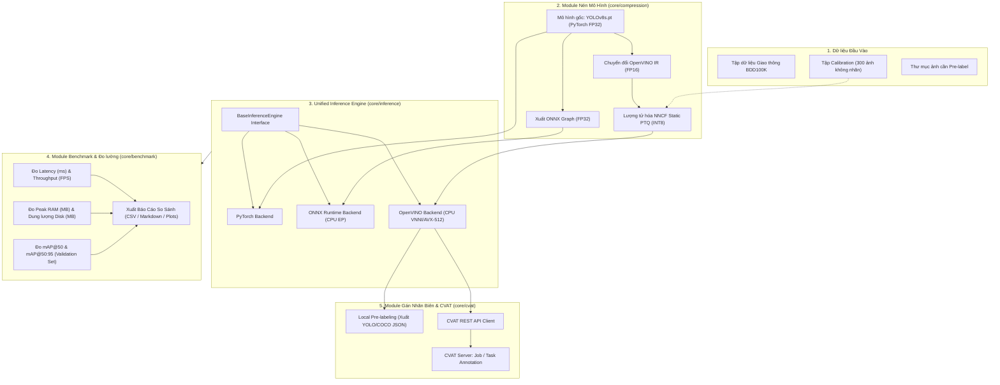

# ĐẶC TẢ KỸ THUẬT HỆ THỐNG (SYSTEM SPECIFICATION)
# Đề tài M38: Model Compression for Edge Pre-Labeling

---

## 1. TỔNG QUAN DỰ ÁN & VẤN ĐỀ CẦN GIẢI QUYẾT

### 1.1. Bối cảnh thực tế (Problem Statement)
Trong các dự án phát triển hệ thống thị giác máy tính cho xe tự hành (Autonomous Vehicles / ADAS) và phân tích giao thông, quy trình gán nhãn dữ liệu (Data Annotation) chiếm tới 70-80% tổng thời gian và chi phí của toàn bộ vòng đời MLOps. Để đẩy nhanh tiến độ, giải pháp **Pre-Labeling** (sử dụng mô hình AI gán nhãn mồi tự động để con người chỉ cần kiểm tra và chỉnh sửa) được áp dụng rộng rãi.

Tuy nhiên, các mô hình phát hiện đối tượng có độ chính xác cao hiện nay (như YOLOv8x, RT-DETR-X) thường có kích thước rất lớn (hơn 100MB, hàng trăm triệu tham số) và đòi hỏi card đồ họa chuyên dụng (GPU Cloud) đắt tiền để vận hành. Điều này dẫn tới 3 nút thắt cổ chai:
1. **Chi phí hạ tầng cao:** Thuê GPU Cloud liên tục cho các đợt pre-labeling quy mô lớn rất tốn kém.
2. **Độ trễ và phụ thuộc đường truyền:** Gửi hàng triệu khung hình ảnh phân giải cao lên Cloud gây tắc nghẽn băng thông mạng.
3. **Bảo mật và riêng tư dữ liệu:** Dữ liệu xe tự hành, camera hành trình thường có tính bảo mật cao, không được phép chuyển ra khỏi mạng nội bộ.

### 1.2. Mục tiêu của đề tài (Objectives)
Đề tài **M38 — Model Compression for Edge Pre-Labeling** tập trung vào việc nghiên cứu, hiện thực hóa và đánh giá một hệ thống **nén mô hình phát hiện đối tượng giao thông (Traffic Object Detection)** để có thể vận hành trực tiếp trên **thiết bị biên và máy trạm annotator (CPU thông thường)** với các tiêu chí định lượng:
- **Tốc độ (Inference Speed):** Tăng tốc độ suy luận từ 2 đến 4 lần trên CPU laptop thông thường (đạt mức 30–50+ FPS).
- **Kích thước mô hình (Model Size):** Giảm dung lượng file mô hình từ 3 đến 4 lần (từ ~45MB xuống còn ~11-12MB).
- **Mức tiêu thụ bộ nhớ (RAM Footprint):** Giảm tải bộ nhớ RAM khi nạp mô hình.
- **Độ chính xác (Accuracy Preservation):** Duy trì độ chính xác của nhãn mồi với mức suy giảm $mAP@50 < 1.5\%$.
- **Tích hợp End-to-End:** Tự động kết nối với công cụ gán nhãn CVAT thông qua REST API để nạp trực tiếp kết quả pre-label vào các Task/Job thực tế.

---

## 2. KIẾN TRÚC HỆ THỐNG (SYSTEM ARCHITECTURE)

Hệ thống được thiết kế theo nguyên lý phân tách tầng rõ ràng, độc lập giữa logic thuật toán nén, engine suy luận, bộ máy đo lường benchmark và giao diện tích hợp nền tảng gán nhãn.

### 2.1. Sơ đồ khối kiến trúc (Architecture Diagram)



---

## 3. CƠ SỞ KỸ THUẬT & TOÁN HỌC CỦA CÁC PHƯƠNG PHÁP NÉN

### 3.1. Lượng tử hóa sau huấn luyện (Post-Training Quantization - PTQ)

Lượng tử hóa là quá trình ánh xạ một tập hợp các giá trị liên tục trong miền số thực 32-bit (FP32) sang miền số nguyên rời rạc có độ chính xác thấp hơn (INT8).

Công thức ánh xạ lượng tử hóa đều (Uniform Quantization):
$$q = \text{clip}\left(\left\lfloor \frac{r}{S} \right\rceil + Z, q_{min}, q_{max}\right)$$

Trong đó:
- $r$: Giá trị số thực (FP32 tensor) của trọng số (weights) hoặc đầu ra kích hoạt (activations).
- $q$: Giá trị số nguyên 8-bit tương ứng ($q \in [-128, 127]$ với Signed INT8 hoặc $[0, 255]$ với Unsigned INT8).
- $S$ (Scale factor): Hệ số tỷ lệ, xác định bởi khoảng giá trị thực:
  $$S = \frac{r_{max} - r_{min}}{q_{max} - q_{min}}$$
- $Z$ (Zero-point): Điểm số nguyên tương ứng với giá trị thực $0.0$. Với phương pháp lượng tử hóa đối xứng (Symmetric Quantization cho trọng số), $Z = 0$.
- $\lfloor \cdot \rceil$: Phép làm tròn số nguyên gần nhất.

Quá trình giải lượng tử hóa (Dequantization) khi tính toán tích chập:
$$\tilde{r} = S \cdot (q - Z)$$

### 3.2. Cơ chế Calibration của NNCF (Neural Network Compression Framework)
Đối với trọng số (Weights), phân phối là cố định nên khoảng $[r_{min}, r_{max}]$ có thể tính toán trực tiếp mà không cần dữ liệu. Tuy nhiên, đối với các lớp kích hoạt (Activations), phân phối phụ thuộc vào dữ liệu đầu vào.

Module nén sử dụng thư viện **NNCF** của Intel với tập **Calibration Dataset (~300 ảnh giao thông)**:
1. Nạp tập ảnh qua mạng ở chế độ đánh giá.
2. Sử dụng thuật toán **MinMax / Percentile Observer** để tìm ngưỡng cắt (clipping threshold) tối ưu cho từng tầng activation, hạn chế tối đa nhiễu lượng tử (quantization noise).
3. Đóng băng các tham số Scale $S$ và Zero-point $Z$ vào đồ thị OpenVINO IR.

### 3.3. Tối ưu hóa đồ thị tính toán (Graph Optimizations)
Trước khi lượng tử hóa, mô hình được áp dụng các bước tối ưu hóa đồ thị:
- **Layer Fusion (Hợp nhất tầng):** Hợp nhất các phép toán `Conv2d + BatchNorm2d + SiLU` thành một phép toán đơn lẻ, loại bỏ việc lưu trữ bộ nhớ đệm trung gian.
- **Constant Folding:** Tính toán trước các biểu thức hằng số tĩnh tại thời điểm biên dịch đồ thị.

---

## 4. CHI TIẾT CÁC MODULE CHỨC NĂNG

### 4.1. Module 1: Model Compression Pipeline (`core/compression/`)
- **Tập tin:** `compressor.py`, `calibration.py`
- **Chức năng:**
  1. Tải checkpoint gốc `yolov8s.pt` đã fine-tune trên tập xe cộ (10 lớp BDD100K).
  2. Xuất mô hình sang định dạng ONNX tiêu chuẩn với opset 17.
  3. Sử dụng OpenVINO Model Optimizer chuyển đổi sang định dạng OpenVINO Intermediate Representation (gồm cặp file `.xml` cấu trúc mạng và `.bin` trọng số) ở độ chính xác FP16.
  4. Sử dụng NNCF nạp tập dữ liệu `calib_data/` để tiến hành Static Post-Training Quantization, tạo ra mô hình `yolov8s_int8.xml` và `yolov8s_int8.bin`.

### 4.2. Module 2: Unified Inference Engine (`core/inference/`)
- **Tập tin:** `base_engine.py`, `ov_engine.py`, `onnx_engine.py`, `torch_engine.py`
- **Thiết kế:** Áp dụng mẫu thiết kế **Factory Pattern** và **Strategy Pattern**:
  ```python
  class BaseInferenceEngine(ABC):
      @abstractmethod
      def predict(self, image: np.ndarray, conf_threshold: float = 0.25) -> List[Detection]:
          pass
  ```
- **Hỗ trợ tối ưu phần cứng:**
  - `OpenVINOEngine`: Tự động cấu hình `CPU_BIND_THREAD`, chế độ `LATENCY` hoặc `THROUGHPUT`, kích hoạt tập lệnh Intel VNNI (Vector Neural Network Instructions) để tính toán ma trận số nguyên 8-bit trên phần cứng.
  - `ONNXEngine`: Sử dụng `CPUExecutionProvider` với tối ưu hóa luồng `IntraOpNumThreads`.

### 4.3. Module 3: Benchmark Suite (`core/benchmark/`)
- **Tập tin:** `speed_benchmark.py`, `accuracy_benchmark.py`, `resource_benchmark.py`
- **Quy trình đo tốc độ:**
  1. **Khởi động (Warmup):** Chạy 20 lượt suy luận ban đầu để ổn định xung nhịp CPU, bộ nhớ đệm L1/L2/L3 và nạp driver.
  2. **Đo thực nghiệm:** Chạy 200 lượt suy luận liên tiếp trên các ảnh có kích thước cố định $640 \times 640$.
  3. **Thống kê:** Tính toán Mean Latency, P50, P90, P99 Latency và Throughput (FPS).
- **Quy trình đo độ chính xác:**
  - Chạy toàn bộ tập validation BDD100K subset (~1,000 ảnh).
  - Tính toán các chỉ số chuẩn: $mAP@50$, $mAP@50:95$, Precision, Recall.
- **Quy trình đo tài nguyên:**
  - Đo kích thước file mô hình trên đĩa cứng (MB).
  - Sử dụng thư viện `psutil` đo dung lượng bộ nhớ Resident Set Size (RSS) tại thời điểm nạp mô hình và trong quá trình suy luận.

### 4.4. Module 4: CVAT Pre-Labeling Client (`core/cvat/`)
- **Tập tin:** `cvat_api.py`, `uploader.py`
- **Chức năng:**
  - Tích hợp với hệ thống CVAT thông qua Token API (`Bearer Token` từ file cấu hình bảo mật).
  - Kết nối tới `Job ID` hoặc `Task ID` cụ thể.
  - Tải frame ảnh xuống local memory $\rightarrow$ chạy inference bằng mô hình OpenVINO INT8 $\rightarrow$ chuyển đổi bounding box sang định dạng payload CVAT $\rightarrow$ đẩy trực tiếp vào CVAT thông qua `PATCH /api/jobs/{id}/annotations?action=create`.

---

## 5. QUY CÁCH DỮ LIỆU & LỚP ĐỐI TƯỢNG (DATASET SCHEMA)

Hệ thống tập trung vào phân hệ 10 lớp giao thông đường bộ chuẩn của **BDD100K**:
1. `pedestrian` (Người đi bộ)
2. `rider` (Người điều khiển xe máy/xe đạp)
3. `car` (Ô tô con / sedan / SUV)
4. `truck` (Xe tải)
5. `bus` (Xe buýt)
6. `train` (Tàu hỏa)
7. `motorcycle` (Xe máy)
8. `bicycle` (Xe đạp)
9. `traffic light` (Đèn giao thông)
10. `traffic sign` (Biển báo giao thông)

---

## 6. CẤU TRÚC THƯ MỤC DỰ ÁN (PROJECT REPOSITORY LAYOUT)

```
d:/Project/M38-Edge-PreLabeling/
├── configs/
│   ├── default_config.yaml         # Cấu hình ngưỡng conf, iou, đường dẫn model
│   └── cvat_config.yaml            # Cấu hình CVAT server URL, token, organization
├── data/
│   ├── calibration/                # 300 ảnh giao thông dùng cho NNCF PTQ
│   └── sample_images/              # Ảnh mẫu phục vụ demo CLI
├── docs/
│   ├── SYSTEM_SPECIFICATION.md     # Tài liệu đặc tả kỹ thuật chi tiết (file này)
│   ├── BENCHMARK_REPORT.md         # Báo cáo kết quả đo đạc thực nghiệm
│   └── USER_GUIDE.md               # Hướng dẫn cài đặt và sử dụng từ A-Z
├── models/
│   ├── raw/                        # Chứa yolov8s.pt gốc
│   ├── onnx/                       # Chứa yolov8s.onnx
│   ├── openvino_fp16/              # Chứa yolov8s_fp16.xml, .bin
│   └── openvino_int8/              # Chứa yolov8s_int8.xml, .bin (mô hình nén)
├── src/
│   ├── core/
│   │   ├── __init__.py
│   │   ├── compression/            # Logic chuyển đổi và lượng tử hóa
│   │   │   ├── __init__.py
│   │   │   ├── exporter.py
│   │   │   └── quantizer.py
│   │   ├── inference/              # Unified inference engine
│   │   │   ├── __init__.py
│   │   │   ├── base.py
│   │   │   ├── ov_engine.py
│   │   │   ├── onnx_engine.py
│   │   │   └── torch_engine.py
│   │   ├── benchmark/              # Bộ đo benchmark
│   │   │   ├── __init__.py
│   │   │   ├── latency.py
│   │   │   ├── accuracy.py
│   │   │   └── memory.py
│   │   └── cvat/                   # Kết nối CVAT REST API
│   │       ├── __init__.py
│   │       ├── client.py
│   │       └── payload_builder.py
│   └── cli/
│       ├── __init__.py
│       └── main.py                 # Entrypoint giao diện dòng lệnh
├── tests/                          # Bộ kiểm thử tự động (Unit & Integration)
│   ├── test_compression.py
│   ├── test_inference.py
│   └── test_cvat_client.py
├── requirements.txt                # Danh sách dependencies
├── pyproject.toml                  # Cấu hình đóng gói package
└── README.md                       # Tổng quan dự án và quickstart
```

---

## 7. ĐẶC TẢ GIAO DIỆN DÒNG LỆNH (CLI INTERFACE SPECIFICATION)

Giao diện dòng lệnh được xây dựng bằng thư viện `click` hoặc `argparse` với 3 lệnh chức năng chính:

### 7.1. Lệnh Nén mô hình (`compress`)
```bash
python -m src.cli.main compress \
    --weights models/raw/yolov8s.pt \
    --calib-dir data/calibration \
    --output-dir models/openvino_int8 \
    --device CPU
```
- **Hành động:** Nạp mô hình gốc $\rightarrow$ xuất ONNX $\rightarrow$ nạp ảnh calibration $\rightarrow$ lượng tử hóa NNCF INT8 $\rightarrow$ lưu file OpenVINO IR vào `output-dir`.

### 7.2. Lệnh Đo kiểm hiệu năng (`benchmark`)
```bash
python -m src.cli.main benchmark \
    --models-dir models/ \
    --val-data data/val_subset/ \
    --iterations 200 \
    --output-report docs/benchmark_results.json
```
- **Hành động:** Tự động quét và chạy so sánh 4 phiên bản mô hình (PyTorch FP32, ONNX FP32, OpenVINO FP16, OpenVINO INT8) $\rightarrow$ in bảng so sánh màu sắc lên console $\rightarrow$ xuất biểu đồ hình cột và bảng Markdown.

### 7.3. Lệnh Gán nhãn tự động lên CVAT (`annotate`)
```bash
python -m src.cli.main annotate \
    --model models/openvino_int8/yolov8s_int8.xml \
    --cvat-job-id 9400 \
    --conf-thresh 0.35 \
    --mode replace
```
- **Hành động:** Kết nối CVAT API của Job 9400 $\rightarrow$ tải ảnh frame $\rightarrow$ suy luận siêu nhanh bằng OpenVINO INT8 trên CPU $\rightarrow$ đóng gói bounding boxes $\rightarrow$ đẩy trực tiếp kết quả vào Job CVAT.

---

## 8. KẾ HOẠCH TRIỂN KHAI THEO GIAI ĐOẠN (IMPLEMENTATION ROADMAP)

- **Giai đoạn 1 (Khởi tạo & Chuẩn bị):**
  - Khởi tạo repo, môi trường virtualenv, cài đặt `openvino`, `nncf`, `ultralytics`, `onnxruntime`.
  - Tải checkpoint YOLOv8s gốc và chuẩn bị tập calibration 300 ảnh.
- **Giai đoạn 2 (Module Nén & Tối ưu hóa):**
  - Hiện thực hóa quy trình xuất ONNX và OpenVINO FP16.
  - Hiện thực hóa pipeline NNCF Post-Training Static Quantization sang INT8.
- **Giai đoạn 3 (Unified Inference & Benchmark Suite):**
  - Viết `UnifiedInferenceEngine` hỗ trợ hoán đổi runtime linh hoạt.
  - Viết module đo Latency, FPS, RAM peak và đánh giá mAP@50.
  - Chạy thực nghiệm đo đạc và thu thập bảng số liệu so sánh.
- **Giai đoạn 4 (Tích hợp CVAT & Hoàn thiện CLI):**
  - Kế thừa client CVAT đẩy kết quả tự động vào Job gán nhãn thực tế.
  - Đóng gói giao diện dòng lệnh CLI đẹp mắt với thư viện `rich`.
  - Soạn thảo Slide báo cáo và hoàn thiện tài liệu hướng dẫn.
